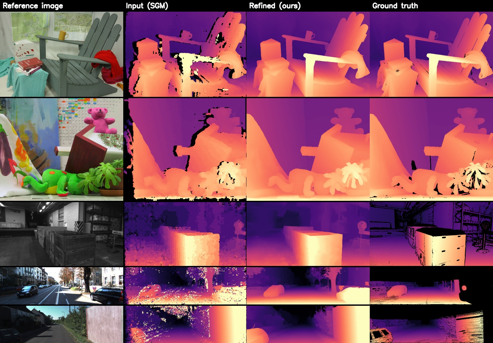
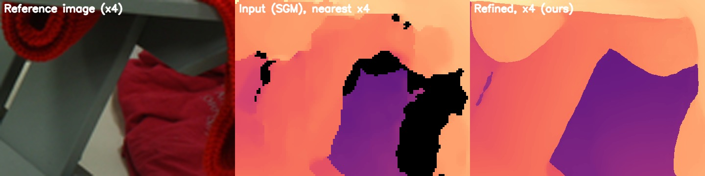

# Neural Disparity Refinement

Test and inference code for:

* **Neural Disparity Refinement**, F. Tosi, F. Aleotti, P. Zama Ramirez, M. Poggi, S. Salti, S. Mattoccia, L. Di Stefano. *IEEE TPAMI*, 2024.
* **Neural Disparity Refinement for Arbitrary Resolution Stereo**, F. Aleotti\*, F. Tosi\*, P. Zama Ramirez\*, M. Poggi, S. Salti, S. Mattoccia, L. Di Stefano. *3DV 2021* (Best Paper Honorable Mention). [[arXiv]](https://arxiv.org/abs/2110.15367)

Given a left image and a raw disparity map (e.g., computed by SGM), the network refines it, and can output it at **any resolution**.
This repository contains the code to run the pre-trained models and to evaluate them. Training code is not released.

## Qualitative results

Refinement of SGM disparity maps (`ndr_tpami.pth`) on some of the images in `samples/` (Middlebury, ETH3D, KITTI 2015, KITTI 2012).
The KITTI ground truth is sparse (dilated here for visibility).



Since the disparity is estimated at continuous coordinates, it can be produced at any resolution (`--upsampling_factor`).
Detail of a Middlebury image at 4x: nearest-neighbor upsampling of the input SGM (center) compared to our output (right).



The figures can be regenerated with `python scripts/qualitative.py`.

## Install

```bash
pip install -r requirements.txt
```

Tested with Python 3.8+ and PyTorch >= 1.10. A GPU is recommended but not required.

## Pre-trained models

| Checkpoint | Paper | Backbone | Training data |
|------------|-------|----------|---------------|
| `checkpoints/ndr_tpami.pth` | TPAMI | ResNeXt-50 | SceneFlow, UnrealStereo4K, VirtualKITTI2, CREStereo |
| `checkpoints/ndr_3dv.pth` | 3DV | VGG-13 | see paper |

Download them from the [v1.0 release](https://github.com/fabiotosi92/neural-disparity-refinement-tpami/releases/tag/v1.0) into `checkpoints/`:

```bash
wget -P checkpoints https://github.com/fabiotosi92/neural-disparity-refinement-tpami/releases/download/v1.0/ndr_tpami.pth
wget -P checkpoints https://github.com/fabiotosi92/neural-disparity-refinement-tpami/releases/download/v1.0/ndr_3dv.pth
```

The network is selected automatically from the checkpoint.

## Inference on your own disparity maps

You need the left RGB image and a disparity map computed by any stereo algorithm.
The disparity can be a `.png` (8-bit: disparity; 16-bit: disparity * 256, KITTI style), a `.npy` or a `.pfm` file, expressed in pixels of the RGB image.

```bash
python apps/inference.py --rgb assets/rgb.png \
                         --disparity assets/disp_sgm.png \
                         --checkpoint checkpoints/ndr_tpami.pth \
                         --results_path results
```

(the same command is in `scripts/inference_example.sh`). It saves the refined disparity as `.npy`, as 16-bit `.png` (disparity * 256) and as a color visualization.

Output at higher resolution (e.g., 4x): the refined disparities are scaled accordingly.

```bash
python apps/inference.py --rgb assets/rgb.png \
                         --disparity assets/disp_sgm.png \
                         --checkpoint checkpoints/ndr_tpami.pth \
                         --upsampling_factor 4
```

If the input disparity was computed at a different resolution than the RGB image (e.g., a low-resolution right image, unbalanced stereo),
it is resized to the RGB resolution; use `--disp_scale` to express its values in RGB pixels (e.g., `--disp_scale 4` if it was computed at 1/4 of the resolution):

```bash
python apps/inference.py --rgb left.png --disparity disp_lowres.npy --disp_scale 4 \
                         --checkpoint checkpoints/ndr_tpami.pth
```

Another example, on a KITTI 2015 sample:

```bash
python apps/inference.py --rgb samples/kitti2015/image_2/000000_10.png \
                         --disparity samples/kitti2015/SGM/000000_10.png \
                         --checkpoint checkpoints/ndr_tpami.pth
```

## Evaluation on the benchmarks

`apps/test.py` refines the SGM disparity maps of a benchmark and reports, for the input and for the refined maps,
the end-point error (`epe`), the percentage of pixels with error larger than 1, 2 and 3 pixels (`bad1`, `bad2`, `bad3`) and the soft edge error (`see`),
on all the pixels with valid ground truth.

### Quick test on the provided samples

A few images of each benchmark are in `samples/` (KITTI 2012, KITTI 2015, Middlebury v3 quarter resolution, ETH3D), together with their SGM disparity maps and ground truth:

```bash
python apps/test.py --dataset kitti2015  --dataroot samples/kitti2015  --split samples --checkpoint checkpoints/ndr_tpami.pth
python apps/test.py --dataset kitti2012  --dataroot samples/kitti2012  --split samples --checkpoint checkpoints/ndr_tpami.pth
python apps/test.py --dataset middlebury --dataroot samples/middlebury --split samples --checkpoint checkpoints/ndr_tpami.pth
python apps/test.py --dataset eth3d      --dataroot samples/eth3d      --split samples --checkpoint checkpoints/ndr_tpami.pth
```

or simply `bash scripts/test_samples.sh [checkpoint]`.

### Full benchmarks

Download the datasets ([KITTI](https://www.cvlibs.net/datasets/kitti/), [Middlebury v3](https://vision.middlebury.edu/stereo/data/scenes2014/), [ETH3D](https://www.eth3d.net/datasets#low-res-two-view-training-data)) and the SGM disparity maps we used as input, [`ndr_inputs.zip`](https://github.com/fabiotosi92/neural-disparity-refinement-tpami/releases/download/v1.0/ndr_inputs.zip) (47 MB).
Unzip the maps anywhere and point `--inputs_root` to the folder of the dataset (or copy them next to the images, with the same structure):

```bash
wget https://github.com/fabiotosi92/neural-disparity-refinement-tpami/releases/download/v1.0/ndr_inputs.zip
unzip ndr_inputs.zip    # -> ndr_inputs/{kitti2012,kitti2015,middlebury,eth3d}

python apps/test.py --dataset kitti2012  --dataroot /path/to/KITTI/2012/training  --inputs_root ndr_inputs/kitti2012  --checkpoint checkpoints/ndr_tpami.pth
python apps/test.py --dataset kitti2015  --dataroot /path/to/KITTI/2015/training  --inputs_root ndr_inputs/kitti2015  --checkpoint checkpoints/ndr_tpami.pth
python apps/test.py --dataset middlebury --dataroot /path/to/MiddEval3/trainingQ  --inputs_root ndr_inputs/middlebury --checkpoint checkpoints/ndr_tpami.pth
python apps/test.py --dataset eth3d      --dataroot /path/to/ETH3D/Stereo/training --inputs_root ndr_inputs/eth3d      --checkpoint checkpoints/ndr_tpami.pth
```

Files used by each benchmark (listed in `split/<dataset>/test.txt`):

| `--dataset` | Left image | Input disparity (`--inputs_root`) | Ground truth |
|-------------|------------|-----------------------------------|--------------|
| `kitti2012` | `colored_0/*_10.png` | `SGM/*_10.png` | `disp_occ/*_10.png` |
| `kitti2015` | `image_2/*_10.png` | `SGM/*_10.png` | `disp_occ_0/*_10.png` |
| `middlebury` (quarter res.) | `<scene>/im0.png` | `<scene>/sgm_opencv.npy` | `<scene>/disp0GT.pfm` |
| `eth3d` | `<scene>/im0.png` | `<scene>/rsgm.png` | `<scene>/disp0GT.pfm` |

Options: `--non_occluded` evaluates Middlebury and ETH3D on non-occluded pixels only (needs `<scene>/mask0nocc.png`), `--results_path DIR` saves the refined disparities.

### Expected results

Percentage of pixels with error larger than the threshold (`bad3` on KITTI, `bad2` on Middlebury, `bad1` on ETH3D), on all pixels.
With `ndr_tpami.pth` (TPAMI paper, last row of the table on the synthetic training datasets):

| KITTI 2012 | KITTI 2015 | Middlebury Q | ETH3D |
|:---:|:---:|:---:|:---:|
| 4.6 | 3.8 | 9.4 | 5.4 |

With `ndr_3dv.pth` (3DV paper): KITTI 2015 5.4, Middlebury Q 11.8, ETH3D 5.2.

## Citation

```bibtex
@article{tosi2024neural,
  title={Neural disparity refinement},
  author={Tosi, Fabio and Aleotti, Filippo and Ramirez, Pierluigi Zama and Poggi, Matteo and Salti, Samuele and Mattoccia, Stefano and Di Stefano, Luigi},
  journal={IEEE Transactions on Pattern Analysis and Machine Intelligence},
  volume={46},
  number={12},
  pages={8900--8917},
  year={2024},
  publisher={IEEE}
}

@inproceedings{aleotti2021neural,
  title={Neural disparity refinement for arbitrary resolution stereo},
  author={Aleotti, Filippo and Tosi, Fabio and Ramirez, Pierluigi Zama and Poggi, Matteo and Salti, Samuele and Mattoccia, Stefano and Di Stefano, Luigi},
  booktitle={2021 International Conference on 3D Vision (3DV)},
  pages={207--217},
  year={2021},
  organization={IEEE}
}
```

## License

The code and the checkpoints are released for non-commercial use only, see [LICENSE](LICENSE).
The images in `samples/` belong to the KITTI, Middlebury and ETH3D datasets and are subject to their original licenses.
